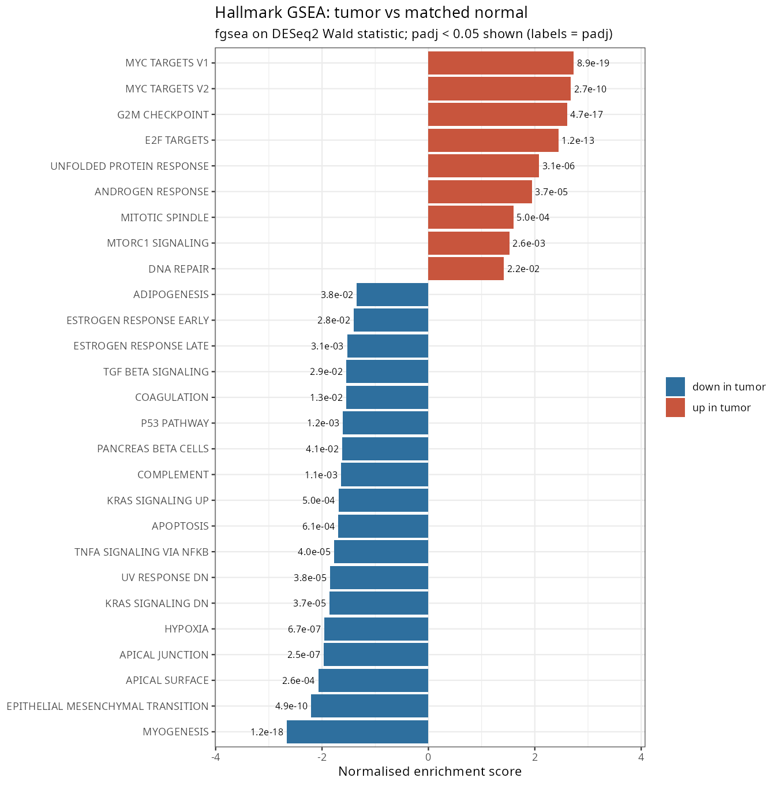
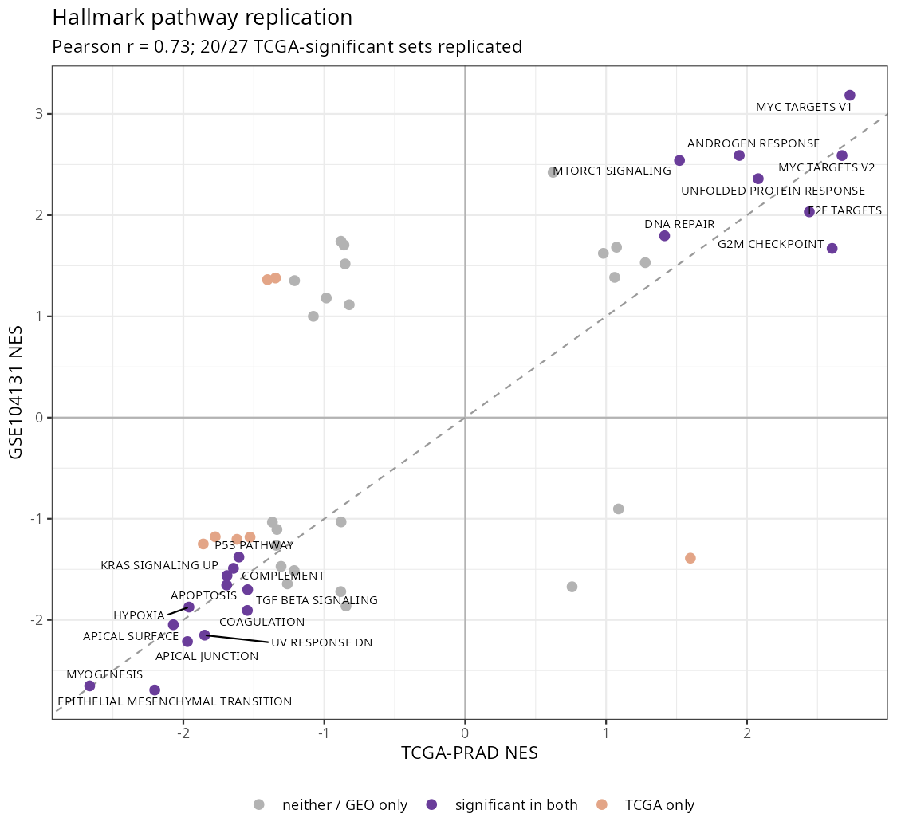

# ProstaGene: Differential Expression & Pathway Analysis in Prostate Cancer

[](https://github.com/Kipchumba-ke/ProstaGene/actions/workflows/ci.yml)
[](https://github.com/Kipchumba-ke/ProstaGene/actions/workflows/docker.yml)

Paired tumor vs. matched normal RNA-seq analysis of TCGA prostate adenocarcinoma (TCGA-PRAD).
It includes pathway enrichment, validation in an independent GEO cohort, and an exploratory
ancestry analysis. Everything runs as one reproducible Snakemake pipeline and renders to a Quarto report.

**[Read the full report](https://Kipchumba-ke.github.io/ProstaGene/)**

**Author:** Kipchumba, Nursing & Public Health · Bioinformatics

---

## Key findings

| | Result |
|---|---|
| **Design** | 52 TCGA-PRAD patients with tumor + matched normal (104 samples); DESeq2 `~ patient + condition` |
| **Differential expression** | 2,233 DEGs (FDR < 0.05, ≥ 2-fold): 763 up, 1,470 down in tumor. Top genes: DLX1, AMACR, PCA3, HPN, TDRD1 |
| **Pathways** | 27 / 50 Hallmark sets enriched. MYC targets, E2F/G2M proliferation and androgen response up; myogenesis, EMT and inflammatory sets down, largely reflecting stromal loss |
| **Robustness** | Excluding 4 borderline-purity pairs: fold-change ρ = 0.99, DEG Jaccard = 0.87 |
| **Validation (GSE104131, 13 pairs)** | 92% of TCGA DEGs same direction; TCGA signature AUC = 0.98; 20 / 27 Hallmark sets replicate (NES r = 0.73) |
| **Tissue composition** | Smooth muscle and basal cells are lower in 47 / 52 and 45 / 52 tumors. MYC, E2F/G2M and androgen-response programmes stay significant after adjusting for stromal, immune, smooth-muscle and basal content; several immune and stromal sets do not |
| **Progression (PFI, 497 tumors, 93 events)** | Proliferation (E2F targets) predicts faster progression unadjusted (HR 1.43 per SD), but no expression score adds information beyond Gleason grade, T stage and age |
| **Ancestry (exploratory)** | Interferon-α/γ sets are higher in Black patients' tumors (n = 57 vs 384 White) and reproduce with genetic ancestry (pathway NES r = 0.87 vs self-reported race). At the patient level the shift is modest (+0.26 SD per unit African ancestry, p = 0.18) and tracks T- and B-cell content. Several top race-associated genes behave like inherited (germline) signals |

<p align="center">
  
  
</p>

**Interactive explorer:** the `explorer/` folder holds a React app with Learn, Clinician and Researcher views; it is published at `/explorer/` next to the report.

## Methodological notes worth reading

- **Self-reported race vs genetic ancestry:** 2 of 53 self-identified Black patients have near-zero African ancestry, and 2 of 394 White patients are majority African ancestry. Genetic ancestry proportions (Carrot-Zhang et al. 2020) were used as a check on every race result.
- **Purity:** four tumors sat near the normal cluster on PCA. They were kept, with a sensitivity analysis, rather than dropped based on how the data looked.
- **A mapping artifact:** the strongest "race-associated" genes were mitochondrial pseudogenes, 14 of 15 higher in Black patients. The likely cause is African mtDNA haplogroups diverging from the European reference mitochondrial genome. They were excluded and reported separately.
- **An anti-conservative test caught and replaced:** pre-ranked GSEA on an ancestry interaction statistic flagged 41 / 50 pathways from just 7 vs 6 patients. A patient-level test (exact Wilcoxon on per-pair pathway scores) found none.
- **Confounding:** in TCGA, race is confounded with tissue source site and Gleason grade. Site-matched models are reported alongside the main ones.

## Pipeline

```
download_tcga → build_paired_set → qc → deseq2 → gsea → geo_validation → ancestry
  → deconvolution → survival → genetic_ancestry → subtypes → export_explorer → report
```

| Step | Script | Tools |
|---|---|---|
| Download | `01_download_tcga.R` | TCGAbiolinks (GDC STAR counts) |
| Pairing | `02_build_paired_set.R` | one aliquot per patient × sample type |
| QC | `03_qc.R` | VST, PCA, sample distances, purity check |
| DGE | `04_deseq2.R` | DESeq2, apeglm, sensitivity analysis |
| Pathways | `05_gsea.R` | fgsea + msigdbr (Hallmark, Reactome), clusterProfiler ORA |
| Validation | `06_geo_validation.R` | GSE104131, NCBI counts, org.Hs.eg.db |
| Ancestry | `07_ancestry.R` | nested DESeq2 design, patient-level Wilcoxon, site-matched models |
| Composition | `08_deconvolution.R` | ESTIMATE (tidyestimate), MCP-counter, marker scores, composition-adjusted DESeq2 |
| Progression | `09_survival.R` | TCGA-CDR progression-free interval, Cox models, C-index |
| Genetic ancestry | `10_genetic_ancestry.R` | Carrot-Zhang et al. 2020 ancestry proportions, AFR-dose model, germline tests |
| Subtypes | `11_subtypes.R` | TCGA 2015 subtype groups, expression-based ERG call, ERG by ancestry, PFI |
| Explorer data | `12_export_explorer.R` | JSON export for the React explorer |
| Report | `reports/report.qmd` | Quarto |

## Running it

Requires Linux or macOS (on Windows, use WSL2) and about 3 GB of disk.

```bash
micromamba create -n prad-dge -f workflow/envs/r-bioc.yaml
micromamba activate prad-dge
Rscript workflow/scripts/install_extras.R
snakemake -n
snakemake --cores 4
```

With conda instead of micromamba, `conda env create -f workflow/envs/r-bioc.yaml` works the same way.

**GEO files (manual download).** NCBI's FTP server can refuse automated downloads, so the two GSE104131 files are fetched by hand into `data/raw/geo/`:

```bash
mkdir -p data/raw/geo && cd data/raw/geo
curl -fL -A "Mozilla/5.0" -O https://ftp.ncbi.nlm.nih.gov/geo/series/GSE104nnn/GSE104131/matrix/GSE104131_series_matrix.txt.gz
curl -fL -o GSE104131_raw_counts_GRCh38.p13_NCBI.tsv.gz \
  "https://www.ncbi.nlm.nih.gov/geo/download/?type=rnaseq_counts&acc=GSE104131&format=file&file=GSE104131_raw_counts_GRCh38.p13_NCBI.tsv.gz"
```

If the FTP link returns 403, download the series matrix from the GEO page for GSE104131 in a browser.

The GDC data release used is recorded in `data/processed/download_provenance.yaml`.

### Docker

```bash
docker pull ghcr.io/kipchumba-ke/prostagene:latest
docker run --rm -v "$PWD/data:/work/data" -v "$PWD/results:/work/results" \
  ghcr.io/kipchumba-ke/prostagene:latest snakemake --cores 4
```

## Testing and continuous integration

Every push runs three GitHub Actions workflows:

| Workflow | What it does |
|---|---|
| `ci.yml` | Builds the conda environment, simulates 8 tumor–normal pairs with **known** effects (`tests/make_synthetic_data.R`), runs QC → DESeq2 → GSEA, and checks the effects are recovered (`tests/check_results.R`). Also type-checks and builds the explorer. |
| `docker.yml` | Builds the image, runs the same synthetic test inside it, and pushes it to the GitHub Container Registry. |
| `pages.yml` | Publishes the report (`docs/`) and the explorer (`/explorer/`) to GitHub Pages. Set **Settings → Pages → Source** to *GitHub Actions*. |

Run the synthetic test locally:

```bash
Rscript tests/make_synthetic_data.R
snakemake --cores 2 results/gsea/fgsea_hallmark.tsv results/de/sensitivity_summary.tsv --allowed-rules qc deseq2 gsea   # targets first: --allowed-rules takes several values
Rscript tests/check_results.R
```

The synthetic run overwrites `data/processed/prad_se_paired.rds` and the `results/` it touches, so use a fresh clone or back them up first.

## Repository layout

```
config/config.yaml              # parameters
workflow/Snakefile              # pipeline
workflow/envs/r-bioc.yaml       # single environment for the whole project
workflow/scripts/01–07_*.R      # one script per step
data/processed/                 # sample sheets, GDC manifest, provenance (.rds git-ignored)
results/{qc,de,gsea,validation,ancestry}/   # tables and figures
reports/report.qmd              # report source
docs/index.html                 # rendered report (GitHub Pages)
```

## Limitations

Bulk tissue mixes cell-state and composition effects; deconvolution scores are relative, not true cell fractions. Purity estimates are incomplete. The validation cohort is small and high-grade only. Progression follow-up is short and the scores were not tested in an independent outcome cohort. African-ancestry samples are few, and race and ancestry are confounded with collection site and grade. All ancestry results are exploratory. See the report for details.

## Data use

TCGA open-access data come from the NCI Genomic Data Commons and are subject to the
[GDC Data Use Agreement](https://gdc.cancer.gov/access-data/data-access-processes-and-tools).
GSE104131 is publicly available from NCBI GEO.

## License

MIT
